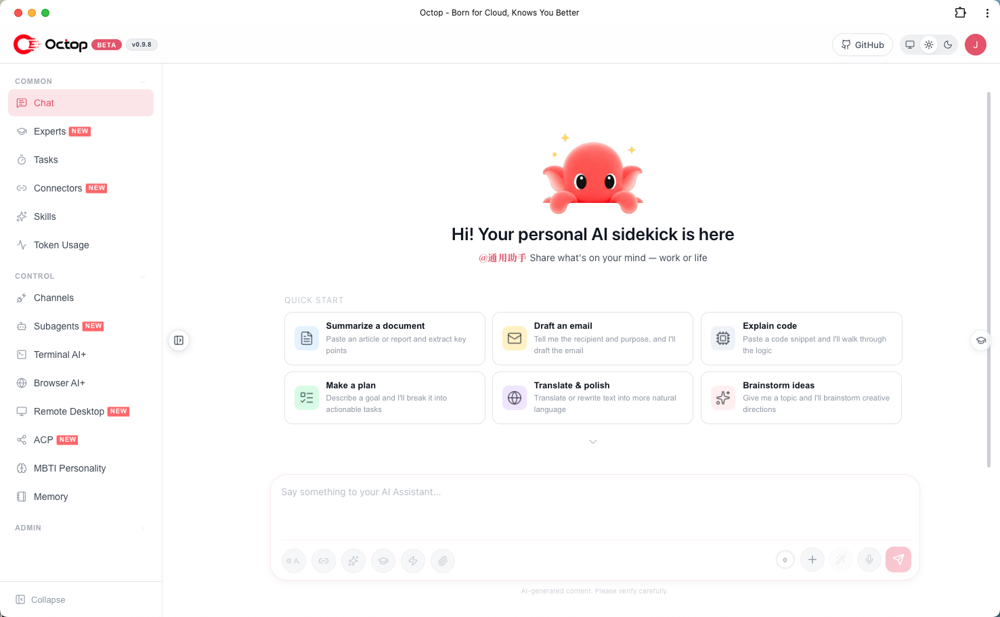

<h1 align="center">Ydsz Worker</h1>

<p align="center">
  <strong>Enterprise AI Assistant Platform — It thinks, it works, it grows with you</strong>
</p>

<p align="center">
  <a href="https://www.python.org/downloads/"></a>
  <a href="LICENSE"></a>
  <a href="https://pypi.org/project/ydsz-worker/"></a>
  <a href="https://github.com/astral-sh/ruff"></a>
</p>

<p align="center">
  <a href="#-highlights">Highlights</a> ·
  <a href="#-overview">Overview</a> ·
  <a href="#-core-technology">Core Technology</a> ·
  <a href="#-features">Features</a> ·
  <a href="#-roadmap">Roadmap</a> ·
  <a href="#-quick-start">Quick Start</a> ·
  <a href="#-contents">Contents</a>
</p>

<p align="center">
  <b>English</b> · <a href="README_CN.md">中文</a>
</p>

---

**Ydsz Worker** (云顶数字工作台) is an open-source, self-hosted enterprise AI assistant platform. More than just a tool — it is an intelligent partner that works in parallel. Through its multi-agent architecture, it builds a digital work environment that is both independent and collaborative for teams and enterprises. Chat is the interface, configuration is the capability, and all data stays on your own machine.

Talk to agents through the Web Dashboard, Feishu, DingTalk, WeCom, QQ, WeChat, and other IM platforms. Extend capabilities with the **expert library**, **Connectors** (OAuth + MCP), and **ACP** integration for IDE workflows.

## ✨ Highlights

| | Feature | Description |
|---|---------|-------------|
| 🧠 | **It thinks** | Built-in RAG knowledge base and long-term memory — conversations are anchored to private data, understanding enterprise context |
| 🛠️ | **It works** | Browser automation, terminal control, remote desktop, scheduled tasks — not just chat, but real action |
| 📈 | **It grows with you** | Self-evolution distills everyday conversations into reusable skills; knowledge bases and expert configurations accumulate value over time |
| 👥 | **Multi-user expert team** | One admin, shared access; built-in expert library — switch specialists per scenario |
| 🤝 | **Cloud collaboration** | Link this Ydsz Worker to another instance to browse peer experts and collaborate across instances |
| 🎭 | **MBTI personas** | 16 personality templates plus an interactive quiz — give each agent a distinct character |
| 🎯 | **AgentTeams** *(Beta)* | A coordinator schedules multiple experts on multi-step work; [details](docs/expert-teams.md) |
| 🔒 | **Security built-in** | JWT multi-user isolation, tool approval, shell command guardrails, and PII redaction — data stays local |
| 🔌 | **Connector ecosystem** | One-click integration with Tencent Docs, Notion, Feishu, WeCom, and more; OAuth and MCP gateway extend resource boundaries — [supported connectors](docs/connectors.md) |
| 💾 | **Pluggable workspace backends** | Local disk, Docker sandbox, PostgreSQL, or COS/S3 for agent files — separate from the control-plane DB |
| 📚 | **Knowledge base** | RAG over your documents; share corpora within a deployment and ground answers in your private data |
| 🧩 | **Plugins** | Extend Ydsz Worker with third-party plugins; bundled plugins are seeded and toggled on demand |
| ↔️ | **ACP bidirectional** | `ydsz-worker acp` for IDE/terminal AI; delegate to OpenCode / Claude Code with permission gates |
| 💻 | **Terminal AI+** | Interactive shell in the browser — AI-assisted command execution and troubleshooting |
| 🌐 | **Browser AI+** | Headless Chromium sessions for web automation, screenshots, and remote browsing |
| 🖥️ | **Remote desktop** | Live screen and input from the dashboard on Linux, Windows, and macOS |
| 🪟 | **Desktop client** | Native Windows / macOS / Linux apps (and FnOS packages) alongside the web dashboard |
| 🏠 | **Self-hosted** | Dashboard, CLI, IM channels, and cron in one `ydsz-worker run` — all data under `~/.octop/` |

## 📌 Overview

Ydsz Worker (云顶数字工作台) is a self-hosted AI assistant platform for enterprises and teams. It runs a single process that serves a web dashboard, a CLI, IM channels (Feishu, DingTalk, WeCom, QQ, WeChat, and more), and cron automation — all sharing one control-plane database under `~/.octop/` (SQLite by default; PostgreSQL optional).

> **Core idea:** Let AI not only answer questions, but also get things done. Knowledge accumulates through conversation, skills evolve through use, and the platform grows with your business.

<details>
<summary>🐾 What can you do with Ydsz Worker</summary>

- **Intelligent customer service** — Connect to WeCom / Feishu / DingTalk, combined with enterprise knowledge bases to automatically answer customer questions.
- **Automated operations** — Scheduled daily/weekly reports and dashboards; browser automation for web workflows.
- **Programming assistant** — Collaborate with IDEs via ACP for code review, bug fixes, and documentation generation.
- **Knowledge management** — Intelligent search across internal team documents, knowledge accumulation, and experience reuse.
- **Personal assistant** — Write weekly reports, organize materials, manage schedules, and control local applications.
- **Remote work** — Remote desktop + terminal AI+ to control your work environment from anywhere.

</details>

## 🧠 Core Technology

| Layer | Technology |
|-------|-----------|
| **Language** | Python 3.12+ |
| **Web framework** | FastAPI + uvicorn |
| **Agent runtime** | LangGraph |
| **Control plane DB** | SQLite (WAL, default) or PostgreSQL (optional) |
| **Frontend** | React 18 + TypeScript + Vite + Ant Design |
| **Scheduling** | APScheduler |
| **ACP** | agent-client-protocol |
| **Build / quality** | hatchling · ruff · mypy · pytest |

Ydsz Worker routes every surface — Web UI, IM, and cron — through one in-process message processing pipeline. Instead of an external queue or message broker, the result is a single, restart-safe process whose entire state is rebuilt from the control-plane database on boot.

## 🤔 Features

### Server & auth
- Multi-user JWT authentication with admin role
- First-run setup wizard (`ydsz-worker init`)
- Interactive API docs at `/api/docs` (off by default — set `"enable_api_docs": true` in `config.json` to enable)

### Experts
- Multiple experts per user; each has its own workspace, providers, channels, and cron
- 16 MBTI persona templates + custom system prompt
- Expert library scanned at boot (`infra/agents/experts/library/`); expert market and in-deployment expert sharing
- **AgentTeams** *(Beta)* — coordinator + member experts for multi-step tasks ([docs/expert-teams.md](docs/expert-teams.md))
- Workspace backends (expert files): local disk, Docker sandbox, PostgreSQL, COS/S3, and other remote stores — distinct from the control-plane database

### Channels & automation
- IM channels: Feishu, DingTalk, WeCom, QQ, WeChat, and more
- Proactive cron jobs with natural-language and slash-command triggers
- Unified message processing across Web UI, IM, and cron surfaces

### Surfaces
- **Web dashboard** — chat, experts / teams, connectors, channels, cron, knowledge, plugins, settings
- **Desktop client** — native apps for Windows / macOS / Linux; FnOS packages for NAS
- **CLI** — `ydsz-worker run`, `ydsz-worker chats`, `ydsz-worker acp`, admin commands
- **HTTP/SSE/WebSocket API** — full programmatic access
- **Remote desktop** — dashboard control of the host desktop session

### Knowledge & plugins
- **Knowledge base** — RAG over your documents; optional sharing within the same deployment
- **Plugins** — install and manage third-party plugins (`ydsz-worker plugin`); bundled plugins are seeded and toggled on demand from the dashboard

### ACP (Agent Client Protocol)

Ydsz Worker supports ACP in two directions:

1. **Inbound** — external tools use **your** Ydsz Worker agent
   ```bash
   ydsz-worker acp --agent main   # stdio ACP server for Zed, OpenCode, …
   ```

2. **Outbound** — Ydsz Worker delegates to external coding agents
   - Dashboard → **ACP** (`/acp`): configure runners (global per user)
   - Enable **acp_runner** per agent, then delegate in chat

Built-in outbound runners include OpenCode, CodeBuddy, Claude Code, and Codex.

Full setup: **[docs/acp.md](docs/acp.md)**.

## 🧭 Roadmap

Here are our mid-to-long term plans:

**Shipped**
- [x] **Shared resource pool** — a central pool of skills and sub-agents that any user can drop into a new expert without rebuilding from scratch.
- [x] **Expert sharing** — publish your experts to other users in the same deployment, so good configurations are reused instead of recreated.
- [x] **PC client** — native desktop apps for Windows / macOS / Linux alongside the web dashboard and IM channels.
- [x] **IM channel integration** — Feishu, DingTalk, WeCom, QQ, WeChat, Telegram, Discord — full platform coverage.

**In progress**
- [ ] **AgentTeams** *(Beta)* — let one coordinator autonomously schedule and orchestrate multiple experts to tackle multi-step tasks.
- [ ] **Mobile client** *(closed beta)* — native mobile apps currently in internal testing.

**Planned**
- [ ] **Self-evolution** — automatically distill everyday conversations into reusable skills, so the assistant grows with you.
- [ ] **Enterprise knowledge brain** — deeper enterprise-level knowledge management and reasoning capabilities.
- [ ] **Plugin marketplace** — a curated market to discover, install, and update third-party plugins without leaving Ydsz Worker.
- [ ] **Conversational control plane** — deepen Ydsz Worker's own skills so chat can cover the full dashboard surface.
- [ ] **Cloud–edge continuum** — run locally while offloading selected tasks to the cloud.

This roadmap may shift as the community grows; treat it as indicative only.

## 🚀 Quick Start

### Prerequisites

- **macOS / Linux / Windows**
- No pre-installed Python required — the installer uses [uv](https://docs.astral.sh/uv/) to provision Python 3.12 in an isolated venv under `~/.octop/`
- A modern multi-core CPU with a few GB of RAM for the process plus model/embedding caches; enough disk for the database, agent workspaces, and document corpora

### 1. Install

**macOS / Linux** — one-line installer (recommended):

```bash
curl -fsSL https://install.ydsz.ai/install.sh | bash
```

**Windows (PowerShell)**:

```powershell
irm https://install.ydsz.ai/install.ps1 | iex
```

**Windows (cmd)** — download and run, or from a cloned repo:

```bat
curl -fsSL https://install.ydsz.ai/install.bat -o install.bat
install.bat
```

After installation, open a **new terminal** or reload your shell. The installer places `ydsz-worker` on your PATH via `~/.octop/bin`. See [scripts/README.md](scripts/README.md) for all install options.

**Desktop app** (GUI, no terminal) — grab the artifact for your platform from [GitHub Releases](https://github.com/njydsz/ydsz-worker/releases/latest):

| Platform | Artifact |
|----------|----------|
| Windows | `YdszDesktop-windows-amd64-<version>.exe` (64-bit) / `YdszDesktop-windows-arm64-<version>.exe` (ARM64) — NSIS installer |
| macOS | `YdszDesktop-darwin-arm64-<version>.dmg` (Apple Silicon) / `YdszDesktop-darwin-amd64-<version>.dmg` (Intel) |
| Linux | `YdszDesktop-linux-amd64-<version>.tar.gz` / `YdszDesktop-linux-arm64-<version>.tar.gz` |
| FnOS NAS | `YdszFnOS-docker-<version>.fpk` (recommended on ARM) / `YdszFnOS-native-<version>.fpk` (x86_64) / `YdszFnOS-native-arm64-<version>.fpk` — install via App Center |

**Alternative — PyPI** (if you already manage Python yourself):

```bash
pip install ydsz-worker
# optional local ONNX embedding model cache: pip install "ydsz-worker[local-embedding]"
```

From a source checkout with uv:

```bash
uv sync --extra local-embedding
```

### 2. Initialize

```bash
ydsz-worker init
```

The interactive wizard creates the SQLite database, JWT secret, and first admin account under `~/.octop/`.

### 3. Run

```bash
# Foreground (API + Web dashboard)
ydsz-worker run

# Custom host / port
ydsz-worker run --host 0.0.0.0 --port 8088

# Register as a system service (systemd / launchd / Windows service)
ydsz-worker service start
```

Open **http://127.0.0.1:8088**. With Docker, a valid `YDSZ_DEFAULT_PASSWORD` creates the admin on first boot (credentials in `/data/.octop/credential.txt`); if it is unset or rejected, open the setup wizard (unlock password in `/data/.octop/octop-login.txt`). Interactive `ydsz-worker init` / the setup wizard asks you to choose a password (at least 8 characters with letters and digits).

### Docker (recommended for production)

```bash
# Build and start
docker compose -f docker/docker-compose.yml up -d

# China mirror when ghcr.io is unreachable (no local build)
docker compose -f docker/docker-compose.cn.yml up -d

# Or build manually
bash docker/docker_build.sh
docker run -d \
  -p 8088:8088 \
  -v octop-data:/data/.octop \
  -e HOME=/data \
  -e YDSZ_DEFAULT_PASSWORD="<strong-password-or-omit-for-setup-wizard>" \
  ydsz-worker:latest
```

Open `http://localhost:8088`. A valid `YDSZ_DEFAULT_PASSWORD` creates the admin on first boot and writes credentials to `/data/.octop/credential.txt`. If it is unset or rejected by the password policy, no admin is created — complete the setup wizard (unlock password in `/data/.octop/octop-login.txt`). Override the username via `YDSZ_ADMIN_USERNAME`.

> **Password policy:** at least 8 characters with letters and digits.

| Variable | Default | Description |
|----------|---------|-------------|
| `YDSZ_PORT` | `8088` | HTTP listen port |
| `YDSZ_DEFAULT_PASSWORD` | _(unset)_ | First-run admin password (Docker bootstrap). Valid -> create admin; unset or rejected -> setup wizard |
| `YDSZ_ADMIN_USERNAME` | `admin` | First-run admin username |
| `YDSZ_DATA` | `~/.octop` | Host data directory (compose bind mount) |

See [`.env.example`](.env.example) for the full list.

## 📑 Contents

- [Highlights](#-highlights)
- [Overview](#-overview)
- [Core Technology](#-core-technology)
- [Features](#-features)
- [Roadmap](#-roadmap)
- [Quick Start](#-quick-start)
- **Deploy & Use**
  - [Install options](#-install-options)
  - [Configuration](#️-configuration)
  - [CLI reference](#-cli-reference)
  - [Web dashboard](#️-web-dashboard)
  - [Data directory](#-data-directory)
- **Architecture & Dev**
  - [Architecture](#️-architecture)
  - [Project layout](#-project-layout)
  - [Development](#️-development)
- **Project Info**
  - [Security & privacy](#-security--privacy)
  - [Contributing](#-contributing)
  - [Changelog](#-changelog)
  - [Related projects](#-related-projects)
  - [License](#-license)

## 📦 Install options

| Method | Platform | Description |
|--------|----------|-------------|
| Remote one-liner | macOS / Linux | `curl .../install.sh \| bash` |
| Remote one-liner | Windows | `irm .../install.ps1 \| iex` or `install.bat` |
| Local script | macOS / Linux | `bash scripts/install.sh` |
| Local script | Windows | `scripts\install.bat` or `install.ps1` |
| PyPI | Any | `pip install ydsz-worker` (optional extras such as `local-embedding`) |
| Docker | Any | `docker/docker-compose.yml`; China mirror: `docker/docker-compose.cn.yml` |

All install scripts provision an isolated environment at `~/.octop/venv` and a `~/.octop/bin/ydsz-worker` wrapper — they do not touch system Python.

### Upgrade

`ydsz-worker update` replaces only the wheel/binary — your `~/.octop/` database, workspaces, secrets, and `config.json` are preserved:

```bash
ydsz-worker update          # fetch and install the latest version, then restart the service if one is registered
```

The schema migrates automatically on next boot; run `ydsz-worker init` only if the setup wizard prompts for a migration. Always back up first (`ydsz-worker backup`) before a cross-version upgrade.

## ⚙️ Configuration

All runtime state lives in `~/.octop/`. Manage it via CLI or edit files directly.

```bash
# LLM providers and models
ydsz-worker models
ydsz-worker provider list

# IM channels
ydsz-worker channel list
ydsz-worker channel install

# Skills (per agent)
ydsz-worker skills list --agent main

# Cron jobs
ydsz-worker cron list
ydsz-worker cron create --help

# Users (admin)
ydsz-worker user list
```

### Supported LLM providers

OpenAI-compatible APIs, DashScope (Qwen), Ollama, and other presets — configure per agent in the dashboard or via `ydsz-worker provider`.

### Supported channels

| Channel | Credentials |
|---------|-------------|
| **Feishu** | App ID, App Secret |
| **DingTalk** | App Key, App Secret |
| **QQ** | Bot AppID, Token |
| **WeChat** | QR bind / account credentials; [CLI](docs/cli.md) |
| **WeCom** | Corp ID, Agent Secret |
| **Web Dashboard** | Enabled by default |

Other kinds (e.g. MQTT) are available via the gateway — see channel setup in the dashboard or CLI.

### Supported connectors

Built-in OAuth / MCP connectors include Tencent Docs, Tencent Meeting, Notion, TickTick, OpenAlex, Feishu CLI, WeCom CLI, Agent Mail, Obsidian, WeKnora, Dify, and more. Names and descriptions are localized (`en` / `zh`).

Full catalog, auth kinds, and MCP modes: **[docs/connectors.md](docs/connectors.md)**. Custom MCP servers can be added in the dashboard.

## 📖 CLI reference

| Command | Description |
|---------|-------------|
| `ydsz-worker init` | Bootstrap `~/.octop/` (DB, admin, JWT secret) |
| `ydsz-worker run` | Start Ydsz Worker in the foreground |
| `ydsz-worker service start` | Install and start as a system service |
| `ydsz-worker service stop` | Stop the system service |
| `ydsz-worker agent` | Create, list, start/stop agents |
| `ydsz-worker channel` | Install and manage IM channels |
| `ydsz-worker chats` | REPL and session management |
| `ydsz-worker acp` | Stdio ACP server for IDE integration |
| `ydsz-worker cron` | Manage scheduled tasks |
| `ydsz-worker models` | Provider presets and model resolution |
| `ydsz-worker skills` | Enable/disable per-agent skills |
| `ydsz-worker plugin` | Install and manage third-party plugins |
| `ydsz-worker backup` | Export / restore backups |
| `ydsz-worker clean` | Remove CLI state or wipe `~/.octop/` |
| `ydsz-worker memory list` | List running agents eligible for memory maintenance |
| `ydsz-worker memory slim [--agent ID]` | Back up and slim SQLite memory through the running host; [details](docs/memory-slim.md) |
| `ydsz-worker memory slim --all` | Sequentially maintain all eligible running agents |
| `ydsz-worker update` | Check for and install updates |

Full reference: **[docs/cli.md](docs/cli.md)**.

## 🖥️ Web dashboard

After `ydsz-worker run`, open **http://127.0.0.1:8088**.

<p align="center">
  
</p>

- **Chat** — real-time conversation with experts and teams
- **Experts** — create experts, pick templates / MBTI personas, share or publish experts, configure providers
- **AgentTeams** *(Beta)* — coordinator + member experts for multi-step work
- **Connectors** — OAuth apps and MCP gateways
- **Channels** — IM platform setup
- **Cron** — visual cron job management
- **Knowledge base** — manage document corpora, semantic retrieval, and in-deployment sharing
- **Plugins** — install, enable, and configure plugins
- **Remote desktop** — live screen and input from the dashboard
- **ACP** — configure outbound coding-agent runners
- **Settings** — users, security, TLS, system

Interactive API docs: **http://127.0.0.1:8088/api/docs** (disabled by default — enable by setting `"enable_api_docs": true` in `config.json`)

## 📁 Data directory

```
~/.octop/                          <- install & data root
├── config.json                    # process config (optional database section)
├── ydsz.db                        # SQLite — users, agents, channels, cron, ...
├── secrets/                       # JWT secret, channel tokens
├── agents/<agent_id>/             # per-agent workspace (SOUL.md, skills, ...)
├── security/tool_guard/           # shell command allow/deny rules
├── logs/                          # runtime logs
├── venv/                          # uv-managed Python (installer layout)
└── bin/ydsz-worker                # PATH wrapper
```

The control plane can also use PostgreSQL — set `database` in `config.json`, or `YDSZ_DATABASE_*` / the first-run wizard. See [docs/configuration.md](docs/configuration.md) for env vars and `config.json`.

## 🏗️ Architecture

```
YdszServer
 ├─ DatabasePool            SQLite (WAL) or PostgreSQL
 ├─ SharedServices          DI root — every repo + config
 ├─ ExpertCatalog           scans agents/experts/library/ at boot
 ├─ UserManager
 │   └─ AgentManager
 │       └─ AgentRuntime (per agent)
 │           ├─ HarnessAgent      Agent runtime (LangGraph)
 │           ├─ IM/UI/Cron entry point
 │           ├─ ChannelManager    IM connections
 │           └─ CronManager       APScheduler
 └─ FastAPI app (uvicorn)
```

Single process. Restart rebuilds state from the control-plane database (local SQLite by default; PostgreSQL optional).

See [docs/architecture.md](docs/architecture.md).

## 📁 Project layout

```
src/octop/
  config.py    env-var config
  launch.py    YdszServer boot + uvicorn
  infra/       business core (agents, gateway, cron, db, users, ...)
  api/         HTTP layer — FastAPI app, routers, JWT, SSE
  cli/         CLI layer — Click commands
  dashboard/   built React SPA (wheel artifact)

dashboard/     frontend source (Vite) — edit here, run make build-frontend

docker/        Docker Compose, entrypoint, build & deploy scripts
tests/         unit/ + integration/
```

## 🛠️ Development

**Prerequisites:** Python 3.12+, Node 18+, [uv](https://docs.astral.sh/uv/)

```bash
# Backend
make install          # pip install -e ".[dev]"
make all              # format-all + lint + typecheck + test (ship bar)

# Frontend (separate terminal)
make dev-frontend     # Vite dev server on :5173 (override with VITE_DEV_PORT)
make build-frontend   # production build -> src/octop/dashboard/
cd dashboard && npx tsc -b
```

Individual targets: `make test`, `make lint`, `make typecheck`, `make format`.

## 🔒 Security & privacy

- **Local-first**: Config, chats, workspaces, and credentials live under `~/.octop/` on your machine.
- **Multi-user isolation**: JWT auth with per-user agents and workspaces.
- **PII redaction & tool approval**: sensitive data is redacted before it leaves the workspace, and risky tools or shell commands require explicit approval under the guardrail rules.
- **Tool guardrails**: User-editable shell command rules under `~/.octop/security/tool_guard/`.
- **No vendor lock-in**: Swap LLM providers, storage backends, and channels without rewriting agents.

## 🤝 Contributing

Contributions are welcome:

1. Fork the repository
2. Create a feature branch (`git checkout -b feature/amazing-feature`)
3. Run `make all` (backend) or `make check-all` (full stack) before submitting
4. Open a Pull Request

See [CONTRIBUTING.md](CONTRIBUTING.md) for the full guide. Security issues: [SECURITY.md](SECURITY.md).

Module boundaries and coding conventions: [AGENTS.md](AGENTS.md).

## 📋 Changelog

See [CHANGELOG.md](CHANGELOG.md) for release history.

## 🔗 Related projects

| Project | Description |
|---------|-------------|
| [LangGraph](https://github.com/langchain-ai/langgraph) | Agent runtime framework — multi-agent orchestration and state management |
| [LangChain](https://github.com/langchain-ai/langchain) | LLM application development framework |
| [FastAPI](https://github.com/fastapi/fastapi) | Modern, high-performance web framework for building APIs |

## 📄 License

This project is licensed under the [MIT License](LICENSE).
